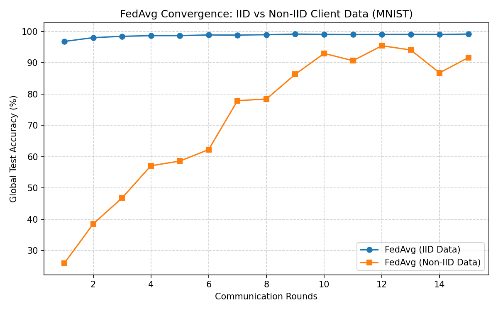

# Federated Averaging (FedAvg) Benchmark in PyTorch

A clean PyTorch implementation of **Federated Averaging (FedAvg)** (McMahan et al., 2017) evaluating global model convergence under **IID** vs. **Non-IID** client data distributions with partial client participation.

## Overview
In real-world distributed machine learning, client devices hold non-identically distributed (Non-IID) data and participate intermittently. This repository simulates a federated network of **10 clients** training a lightweight Convolutional Neural Network (CNN) on the **MNIST** dataset across **15 communication rounds** (50% client sampling per round).

### Key Features
* **Data Partitioning:** Supports uniform random splits (**IID**) and label-skewed shard splits (**Non-IID**, max 2 digit classes per client).
* **Partial Participation:** Randomly samples 50% of clients per communication round.
* **Client Drift Analysis:** Configurable local epochs (`E`) and learning rates to study local objective drift on heterogeneous data.

## Results


### Key Findings

| Metric | IID (E=2) | Non-IID (E=2) |
|---|---|---|
| Round 1 Accuracy | 96.80% | 25.93% |
| Round 5 Accuracy | 98.66% | 58.58% |
| Round 10 Accuracy | 99.07% | 92.98% |
| **Final Accuracy (R=15)** | **99.16%** | **91.67%** |
| Convergence Stability | ✅ Smooth & monotone | ⚠️ High variance, oscillating |

#### IID Data
Converges smoothly and rapidly — reaching **>98% by Round 3** and stabilising above **99%** from Round 9 onward. Homogeneous client data means local SGD updates are well-aligned with the global objective, so aggregation always improves the model.

#### Non-IID Data
Exhibits **slow initial convergence** (25.93% at Round 1) and **high inter-round variance** throughout training. With only 2 digit classes per client, local models overfit their skewed distributions and pull the global model in conflicting directions — a phenomenon known as **client drift** (or objective inconsistency). This manifests as oscillation between 86–95% in later rounds despite near-convergence, a gap of **~7.5 percentage points** below the IID ceiling.

> **Takeaway:** Data heterogeneity is the primary bottleneck in federated optimisation. Mitigation strategies include reducing local epochs (`E=1`), adding proximal regularisation (FedProx), or using momentum-corrected aggregation (SCAFFOLD, FedNova).

## Quickstart
```bash
# Install dependencies
pip install torch torchvision numpy matplotlib

# Run simulation and generate convergence plot
python fedavg_simulation.py
```

## Project Structure
```
fedavg-pytorch-benchmark/
├── fedavg_simulation.py   # End-to-end simulation: CNN, partitioning, local SGD, FedAvg, evaluation
├── fedavg_results.png     # Convergence plot: IID vs Non-IID test accuracy over rounds
└── README.md
```

* `fedavg_simulation.py` — Covers CNN definition, IID/Non-IID partitioning, local SGD updates, FedAvg server aggregation, and global evaluation.
* `fedavg_results.png` — Generated test accuracy curves comparing IID and Non-IID data distributions across 15 communication rounds.

## References
* McMahan, B., Moore, E., Ramage, D., Hampson, S., & Arcas, B. A. (2017). [Communication-Efficient Learning of Deep Networks from Decentralized Data](https://arxiv.org/abs/1602.05629). *AISTATS 2017*.
* Li, T., et al. (2020). [Federated Optimization in Heterogeneous Networks (FedProx)](https://arxiv.org/abs/1812.06127). *MLSys 2020*.
* Karimireddy, S. P., et al. (2020). [SCAFFOLD: Stochastic Controlled Averaging for Federated Learning](https://arxiv.org/abs/1910.06378). *ICML 2020*.
